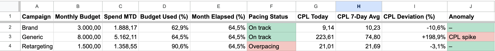
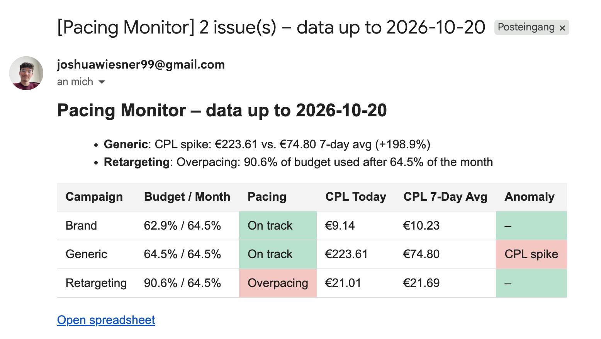
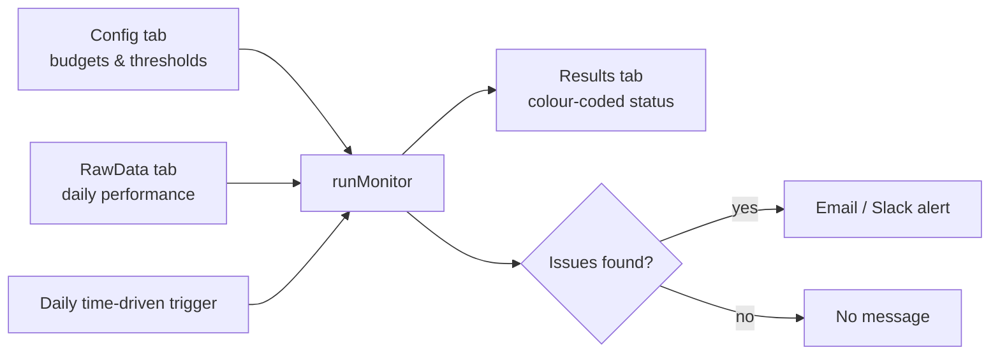
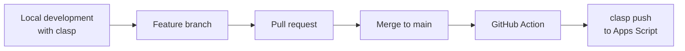

# Pacing Monitor

Automated budget pacing and CPL anomaly monitoring for paid search campaigns, built with Google Apps Script, versioned on GitHub and deployed automatically via GitHub Actions.

> **Demo project:** all data is synthetic and generated by the script itself. No real client or company data is used.

**Links:** [Demo spreadsheet (view only)](LINK-TO-DEMO-SHEET) · [2-minute walkthrough video](LINK-TO-VIDEO)

## The problem

Paid media managers typically check by hand, every day, whether campaigns are spending in line with their monthly budget and whether key metrics such as cost per lead (CPL) are drifting. This manual routine is repetitive, easy to skip on busy days, and problems are often noticed too late, after budget has already been wasted.

## The solution

A Google Sheet acts as the single control panel. Every morning, an Apps Script:

1. reads the campaign settings (monthly budgets, CPL thresholds) from the `Config` tab,
2. analyses the daily performance data in `RawData`,
3. calculates **budget pacing** and detects **CPL anomalies**,
4. writes a colour-coded overview to the `Results` tab,
5. sends an email (and optionally a Slack message) **only when something needs attention**.

## How it works

**Pacing.** The share of the monthly budget already spent is compared with the share of the month that has passed. A ratio more than 15% above or below 1 is flagged as *Overpacing* or *Underpacing*.

**CPL anomalies.** The CPL of the latest day is compared with the average CPL of the 7 days before it. If the increase exceeds the campaign-specific threshold from the `Config` tab, a *CPL spike* is reported. Days with spend but no conversions are flagged separately.

**Demo data.** `generateDemoData()` creates reproducible synthetic data (seeded random generator) for a fictional client and deliberately injects two anomalies, an overpacing campaign and a CPL spike, so the monitor's behaviour can be verified at any time.

## Development and deployment workflow

- Code is developed locally and synced with Apps Script using [clasp](https://github.com/google/clasp).
- Every change goes through a feature branch and a pull request.
- On every merge to `main`, a GitHub Action deploys the code to the Apps Script project automatically. Credentials are stored as a GitHub secret, never in the repository.
- `.claspignore` ensures only the Apps Script source files are uploaded.

## Project structure

| File | Purpose |
|---|---|
| `DemoData.js` | Generates synthetic performance data with injected anomalies |
| `Monitor.js` | Pacing calculation, anomaly detection, Results sheet output |
| `Notify.js` | HTML email and optional Slack notification, daily job |
| `Triggers.js` | Installs and removes the daily time-driven trigger |
| `Menu.js` | Custom spreadsheet menu for running all functions manually |
| `.github/workflows/deploy.yml` | Automatic deployment on merge to `main` |

## Setup

1. Make a copy of the [demo spreadsheet](LINK-TO-DEMO-SHEET). The script is copied along with it.
2. Reload the sheet and use the **Pacing Monitor** menu: *Generate demo data* → *Run monitor* → *Send report now*.
3. Optional: set `RECIPIENT_EMAIL` and `SLACK_WEBHOOK_URL` under *Project Settings → Script Properties*.
4. Choose *Schedule daily run* to receive a report every morning.

To work on the code locally: install clasp, run `clasp login` and `clasp clone <script-id>`, then use the branch and pull request workflow described above.

## Built with AI coding assistants

This project was built with Claude as an AI coding assistant: for drafting the initial implementation, explaining and reviewing logic, and working through setup steps such as clasp and GitHub Actions. All generated code was reviewed, run and verified against the synthetic test scenarios before being merged.

## Possible next steps

- Replace the demo data source with a Google Ads Script that exports daily campaign data into `RawData`
- Local unit tests with a mocked `SpreadsheetApp`, executed in the GitHub Action before every deployment
- Additional checks, e.g. CTR drops or sudden impression losses
